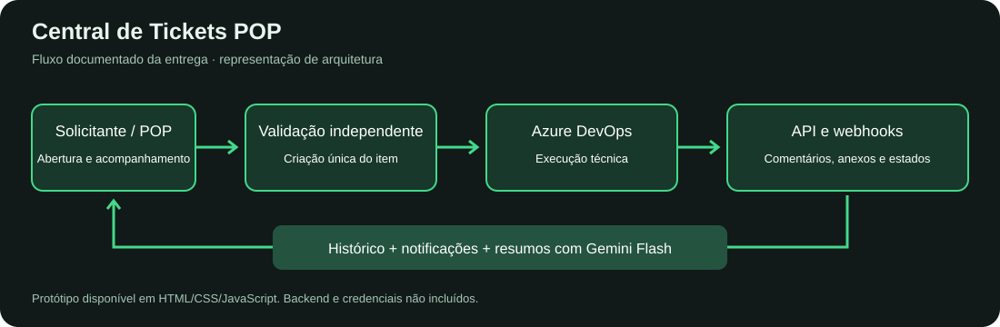
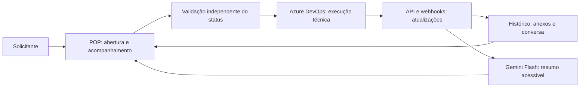

# Central de Tickets POP | Azure DevOps + IA

Desenvolvi esta central em conjunto com a diretoria para organizar a abertura, classificação e acompanhamento de demandas de Operações, Tecnologia e Produto. O POP passou a concentrar a experiência do solicitante, enquanto o Azure DevOps permaneceu como ferramenta de execução técnica.

A entrega reúne abertura guiada, lista e Kanban, validação técnica, comunicação no ticket, anexos, notificações e resumos com Gemini Flash. A integração foi concebida para manter o contexto entre a solicitação de negócio e o trabalho técnico.

**Situação registrada no documento de entrega:** escopo concluído, aguardando reunião de validação e repasse. Este repositório preserva o protótipo e a documentação recuperados; a entrada em operação não foi confirmada pelos materiais disponíveis.

## Problema que resolvi

Solicitações, atualizações técnicas e retornos ao cliente precisavam de uma visão comum. Minha proposta foi concentrar a jornada no POP, permitindo acompanhar responsáveis, prioridade, severidade, conversas e histórico sem exigir que o solicitante utilizasse o Azure DevOps diretamente.

## Entrega e diferenciais

- Abertura em etapas: setor → tipo → área → detalhes, com regras por fila e anexos obrigatórios em rotinas padronizadas.
- Sincronização documentada de status, prioridade, severidade, responsáveis, comentários e anexos com Azure DevOps.
- Validação independente do status operacional, com `validated_at` e `validated_by`, para impedir que um webhook posterior reverta a aprovação.
- Criação única do item no Azure após validação e deduplicação de atualizações por hash.
- Responsáveis com regras por tipo: em BUG, seleção no POP sem envio ao Azure; em RTN e demais tipos, leitura a partir do Azure.
- Conversa com imagens, anexos, alertas de leitura e histórico de atualizações.
- Resumos com Gemini Flash para traduzir atualizações técnicas em linguagem acessível ao solicitante.
- Integrações relacionadas com e-mail, Portal ISO e identificação do solicitante a partir de Vendas/Pipedrive.

## Arquitetura documentada

O desenho representa a entrega descrita; o código do backend e das funções de integração não está incluído nos materiais recuperados.

## Protótipo navegável

Abra [prototype/index.html](prototype/index.html) no navegador após baixar o repositório. É uma versão histórica do Google Stitch, adaptada com dados fictícios e sem avatares externos. CSS e fontes dependem de acesso à internet, por Tailwind CDN e Google Fonts.

É possível explorar a navegação, lista, Kanban, detalhes e a simulação de validação. Os dados ficam em memória e são restaurados ao recarregar. Alguns controles são apenas visuais. O protótipo não envia e-mails, não acessa Azure e não executa Gemini.

**Evolução importante:** a tela histórica ainda contém estados e opções anteriores. A entrega descrita posteriormente removeu Reprovado do Kanban, restringiu QST à fila de Produto e separou a validação do status. Consulte as regras atuais documentadas antes de usar a tela como referência funcional.

## Documentação

- [Entrega e regras de negócio](docs/entrega-e-regras.md)
- [APIs, eventos e limites do material recuperado](docs/integracoes.md)
- [Funções JavaScript recuperadas](docs/funcoes-do-prototipo.md)
- [Roteiro de demonstração e validação](docs/validacao.md)
- [Origem dos materiais e anonimização](docs/origem-e-escopo.md)
- [Exemplo fictício de resumo com IA](examples/resumo-solicitante.md)

## Tecnologias

**Código disponível:** HTML, CSS, JavaScript, Tailwind CSS e Google Stitch como ferramenta de prototipação.

**Entrega documentada:** Azure DevOps, APIs, webhooks, Gemini Flash, atualização em tempo real, anexos com URLs assinadas, e-mail e Portal ISO. A identificação do solicitante considera Vendas/Pipedrive.

Não publico credenciais, endpoints internos, dados de clientes nem o PDF interno de entrega. Os ganhos descritos são funcionais; não há uma medição de economia de horas neste material.
